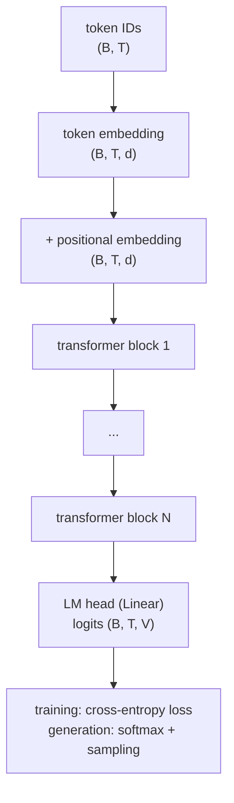
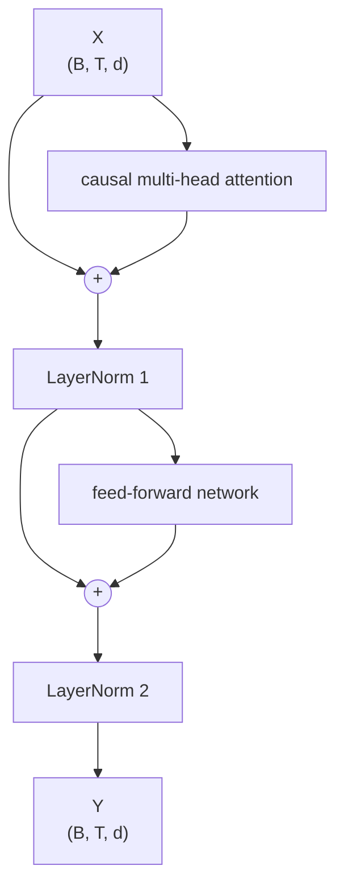
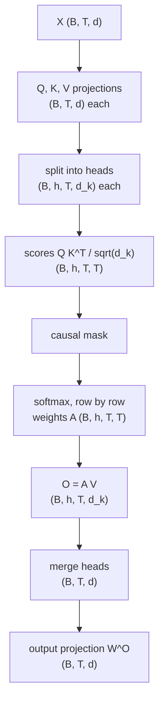

# The forward pass

How token IDs become next-token predictions, with the shape at every step.

## Contents

1. [Overview](#1-overview)
2. [Embeddings](#2-embeddings)
3. [The transformer block](#3-the-transformer-block)
4. [Causal multi-head attention](#4-causal-multi-head-attention)
5. [The feed-forward network](#5-the-feed-forward-network)
6. [Layer normalisation](#6-layer-normalisation)
7. [The LM head and the loss](#7-the-lm-head-and-the-loss)
8. [Shapes and parameter count](#8-shapes-and-parameter-count)

---

## 1. Overview

A decoder-only transformer in the style of GPT-1: post-norm blocks, learned positional embeddings, and a ReLU feed-forward network.

Each position's output predicts the **next** token. Causal attention means position $t$ can only use tokens $0, \ldots, t$.

---

## 2. Embeddings

**Token embedding.** A lookup table $W_E \in \mathbb{R}^{V \times d}$ with one learned row per token:

$$
E[b, t, :] = W_E[y_{bt}, :]
$$

**Positional embedding.** A table $W_P \in \mathbb{R}^{C \times d}$ with one learned row per position ($C$ is the context length). The same position vector is added to every sequence:

$$
X_0[b, t, :] = E[b, t, :] + W_P[t, :]
$$

The token embedding says *what* each token is, and the positional embedding says *where* it is. Without positions, attention would treat the input as an unordered set.

---

## 3. The transformer block

Each block has two sub-layers. Each sub-layer's output is **added** to its input (a residual connection), then normalised (post-norm):

$$
S_1 = X + \operatorname{MultiHead}(X), \qquad X_1 = \operatorname{LN}_1(S_1)
$$

$$
S_2 = X_1 + \operatorname{FFN}(X_1), \qquad Y = \operatorname{LN}_2(S_2)
$$

- **Attention** lets each token gather information from earlier tokens.
- **The feed-forward network** processes each token's vector on its own.
- **Residual connections** mean each sub-layer only has to learn an *update* to the vector, and give the gradient a direct path back through the network.

The shape stays $(B, T, d)$ throughout, so blocks can be stacked.

---

## 4. Causal multi-head attention

### Scaled dot-product attention

Each token produces a **query** (what it is looking for), a **key** (what it offers) and a **value** (what it passes on):

$$
Q = XW^Q, \qquad K = XW^K, \qquad V = XW^V
$$

$$
\operatorname{Attention}(Q, K, V) = \operatorname{softmax}\!\left(\frac{QK^\top}{\sqrt{d_k}} + M\right)V
$$

- Entry $(i, j)$ of $QK^\top$ is $\mathbf{q}_i \cdot \mathbf{k}_j$: how well token $i$'s query matches token $j$'s key.
- Dividing by $\sqrt{d_k}$ keeps the scores at variance about 1 whatever the head size, so softmax doesn't saturate.
- Softmax turns each row of scores into weights that sum to 1.
- Multiplying by $V$ gives each token a weighted average of the values.

### The causal mask

Position $i$ may only attend to positions $j \le i$. The mask $M$ sets every future score to $-\infty$, which softmax turns into a weight of exactly 0. For $T = 4$:

$$
M =
\begin{bmatrix}
0 & -\infty & -\infty & -\infty \\
0 & 0 & -\infty & -\infty \\
0 & 0 & 0 & -\infty \\
0 & 0 & 0 & 0
\end{bmatrix}
$$

This is what makes training on every position at once valid: each position's target is the next token, which it can't see.

### Multiple heads

With $h$ heads, the $d$ features are split into $h$ groups of $d_k = d / h$. Each head runs its own attention, so each can learn a different pattern. The outputs are concatenated and mixed by an output projection:

$$
\operatorname{MultiHead}(X) = \operatorname{Concat}(\text{head}_1, \ldots, \text{head}_h)\,W^O
$$

**Splitting heads** reshapes $(B, T, d) \to (B, T, h, d_k)$, then swaps axes to $(B, h, T, d_k)$, so each head's $(T, d_k)$ matrix sits in the last two axes. Batched matrix multiplication then runs every head of every sequence at once.

---

## 5. The feed-forward network

A two-layer MLP applied to each position separately, expanding to $d_{\text{ff}} = 4d$ and back:

$$
\operatorname{FFN}(X) = \operatorname{ReLU}\!\left(XW_1 + \mathbf{1}\mathbf{b}_1^\top\right)W_2 + \mathbf{1}\mathbf{b}_2^\top
$$

The hidden units act like pattern detectors: ReLU keeps the ones that fire (positive) and zeroes the rest, and the second layer turns the detected patterns into an update to the token's vector. Without the ReLU, the two layers would collapse into a single linear map.

---

## 6. Layer normalisation

Each position's vector is normalised to mean 0 and variance 1, then scaled and shifted by learned per-feature parameters:

$$
\hat{x}_i = \frac{x_i - \mu}{\sqrt{\sigma^2 + \epsilon}},
\qquad
y_i = \gamma_i\,\hat{x}_i + \beta_i
$$

where $\mu$ and $\sigma^2$ are the mean and variance of that vector's own $d$ entries. This keeps activations at a stable scale however many blocks and residual additions they pass through. $\boldsymbol{\gamma}$ (gain) starts at 1 and $\boldsymbol{\beta}$ (bias) at 0.

---

## 7. The LM head and the loss

**LM head.** A Linear layer from $d$ to $V$: one score (logit) per vocabulary token at every position.

$$
Z = X_{\text{final}}W_{\text{head}} + \mathbf{1}\mathbf{b}_{\text{head}}^\top
\qquad (N \times V)
$$

**Loss (training).** Cross-entropy between the softmax of each row and the correct next token, averaged over all $N$ positions:

$$
L = -\frac{1}{N}\sum_{n=1}^{N}\log p^{(n)}_{y_n}
$$

**Generation.** Softmax over the last position's logits gives the next-token distribution, which is sampled (see `data-and-generation.md`).

---

## 8. Shapes and parameter count

### Shape trace (default configuration)

$B = 16$, $T = 64$, $d = 64$, $h = 4$, $d_k = 16$, $V = 65$:

| step | shape |
|---|---|
| token IDs | (16, 64) |
| embeddings + positions | (16, 64, 64) |
| Q, K, V after splitting heads | (16, 4, 64, 16) |
| attention scores and weights | (16, 4, 64, 64) |
| attention output after merging heads | (16, 64, 64) |
| feed-forward hidden layer | (16, 64, 256) |
| block output | (16, 64, 64) |
| logits | (16, 64, 65) |
| loss | scalar |

### Parameter count

| part | parameters |
|---|---|
| token embedding ($65 \times 64$) | 4,160 |
| positional embedding ($64 \times 64$) | 4,096 |
| attention, per block ($4 \times (64 \times 64 + 64)$) | 16,640 |
| two LayerNorms, per block ($2 \times (64 + 64)$) | 256 |
| feed-forward, per block ($64 \times 256 + 256 + 256 \times 64 + 64$) | 33,088 |
| **one block** | **49,984** |
| 4 blocks | 199,936 |
| LM head ($64 \times 65 + 65$) | 4,225 |
| **total** | **212,417** |